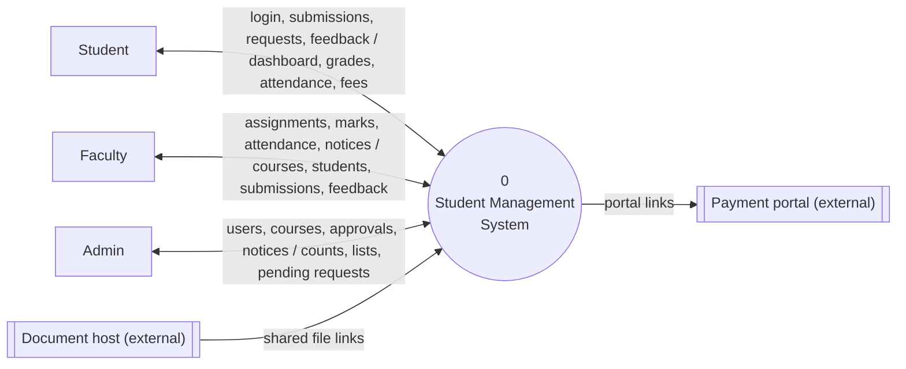
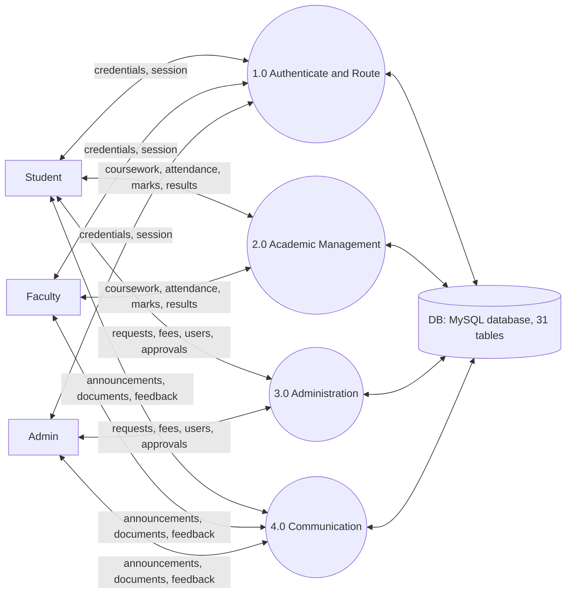
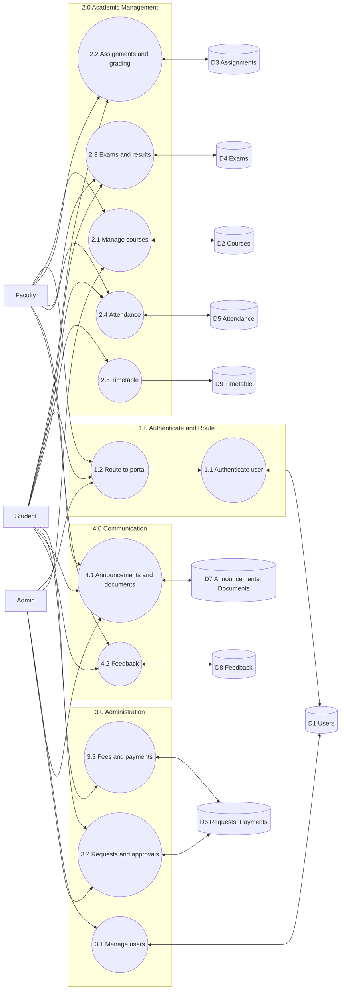
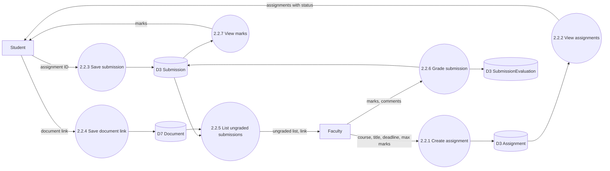

# System Analysis: Context Diagram and DFD Levels 0, 1 and 2

One diagram per level for the whole system. Numbering is consistent: process 0 (context) is exploded into 1.0 to 4.0 (Level 0), each of those into x.1, x.2 (Level 1), and process 2.2 into 2.2.1 to 2.2.7 (Level 2). GitHub renders the Mermaid blocks below.

## Context diagram

## DFD Level 0

## DFD Level 1 (all four processes exploded)

Student also reads D2 through 2.1 when viewing courses; faculty reads D2 for course and student lists. Those links are omitted from the picture to keep it readable.

## DFD Level 2 (process 2.2 Assignments and grading)

Steps 2.2.3 and 2.2.4 run in one database transaction, so a failure rolls both back.

## Data store catalogue
| Store | Name | Tables |
|---|---|---|
| D1 | Users | Person, Student, Faculty, Admin, Department, Program |
| D2 | Courses | Course, Teaches, Enrollment, Prerequisite |
| D3 | Assignments | Assignment, Submission, SubmissionEvaluation (+ SubmissionDocument, AssignmentDocument) |
| D4 | Exams | Exam, ExamResult, ExamEvaluation |
| D5 | Attendance | Attendance |
| D6 | Requests, Payments | Request, Payment, PaymentAudit (+ RequestDocument, PaymentDocument) |
| D7 | Announcements, Documents | Announcement, AnnouncementCourse, AnnouncementDepartment, Document, CourseDocument |
| D8 | Feedback | Feedback |
| D9 | Timetable | Timetable |
