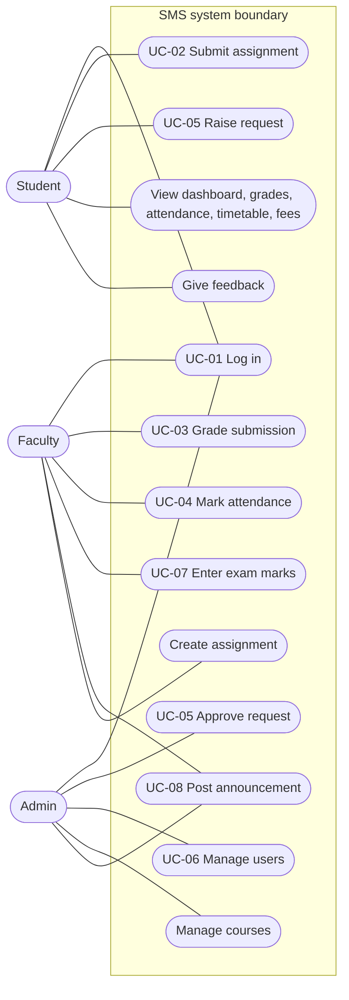

# Use-Case Diagram and Specifications

## Use-case diagram

Every role includes UC-01 (Log in) before any other use case.

## UC-01 Log in
| Field | Detail |
|---|---|
| Actor | Student, Faculty, Admin |
| Precondition | User exists in `Person` with the matching `Role`; the portal server is running |
| Trigger | User submits ID or email and password on a portal login page |
| Main flow | 1. System looks up `Person` by email or ID and role. 2. Compares the password. 3. Stores user ID, name and role in the session. 4. Redirects to the role dashboard. |
| Alternate flow | A1. User not found or role mismatch: show an error. A2. Wrong password: same message, stay on login. |
| Postcondition | Authenticated session for exactly one role |
| Rule | Passwords are compared in plain text today (NFR-SEC-02) |

## UC-02 Submit assignment
| Field | Detail |
|---|---|
| Actor | Student |
| Precondition | Logged in; enrolled in the assignment's course |
| Main flow | 1. Create a `Document` (type link, Private). 2. Insert a `Submission`, or update `SubmittedAt` if one exists. 3. Link them in `SubmissionDocument`. 4. Commit and show success. |
| Alternate flow | A1. Any step fails: roll back and show the error |
| Postcondition | Submission is visible to the faculty member as ungraded |
| Rule | One submission per (assignment, student) |

## UC-03 Grade submission
| Field | Detail |
|---|---|
| Actor | Faculty |
| Precondition | Logged in; a submission exists for an assignment created by this faculty with no marks |
| Main flow | 1. Open the submissions list and the document link. 2. Enter marks and comments. 3. System updates `Submission.Marks/Comments`. 4. System inserts a `SubmissionEvaluation` row. |
| Alternate flow | A1. Marks above maximum: validation is planned, not in code |
| Postcondition | Student sees the marks on assignments and dashboard |

## UC-04 Mark attendance
| Field | Detail |
|---|---|
| Actor | Faculty (verification by Admin is planned) |
| Precondition | Faculty teaches the course; student is enrolled |
| Main flow | 1. Select course. 2. System lists enrolled students. 3. Choose student, date, Present or Absent. 4. System inserts `Attendance` with `RecordedBy`. |
| Alternate flow | A1. Duplicate (course, student, date): rejected with a message |
| Postcondition | Student attendance percentage reflects the record |

## UC-05 Raise and approve request
| Field | Detail |
|---|---|
| Actors | Student (raise), Admin (decide) |
| Main flow | 1. Student picks a type and submits. 2. System stores `Request` as Pending. 3. Admin opens the approvals list. 4. Admin approves or rejects. 5. System updates the status. 6. Student sees the new status. |
| Alternate flow | A1. Request not found: show an error |
| Gap | `ApprovedBy` and `ApprovedAt` are not set by current code |

## UC-06 Manage users
| Field | Detail |
|---|---|
| Actor | Admin |
| Main flow (add) | 1. Admin fills role, name, email, password and role-specific fields. 2. System inserts `Person` and gets its ID. 3. System inserts the `Student` or `Faculty` row. 4. Commit and show success. |
| Alternate flow | A1. Duplicate email or invalid program/department: roll back and show error. A2. Delete is blocked by foreign keys if dependent rows exist. |
| Rule | Delete is a GET link today and should become POST with confirmation |

## UC-07 Enter exam marks
| Field | Detail |
|---|---|
| Actor | Faculty |
| Main flow | 1. Select exam and student ID. 2. System verifies the student exists. 3. Insert a result, or update marks if one exists. |
| Alternate flow | A1. Student not found: error. A2. Integrity error: roll back. |
| Gap | `Grade` is not set, so CGPA cannot use new results (FR-F10) |

## UC-08 Post announcement
Faculty or Admin writes a message, optionally picks a course or department audience, and the system saves an `Announcement` plus `AnnouncementCourse` or `AnnouncementDepartment` rows. Students see the latest five on the dashboard.
